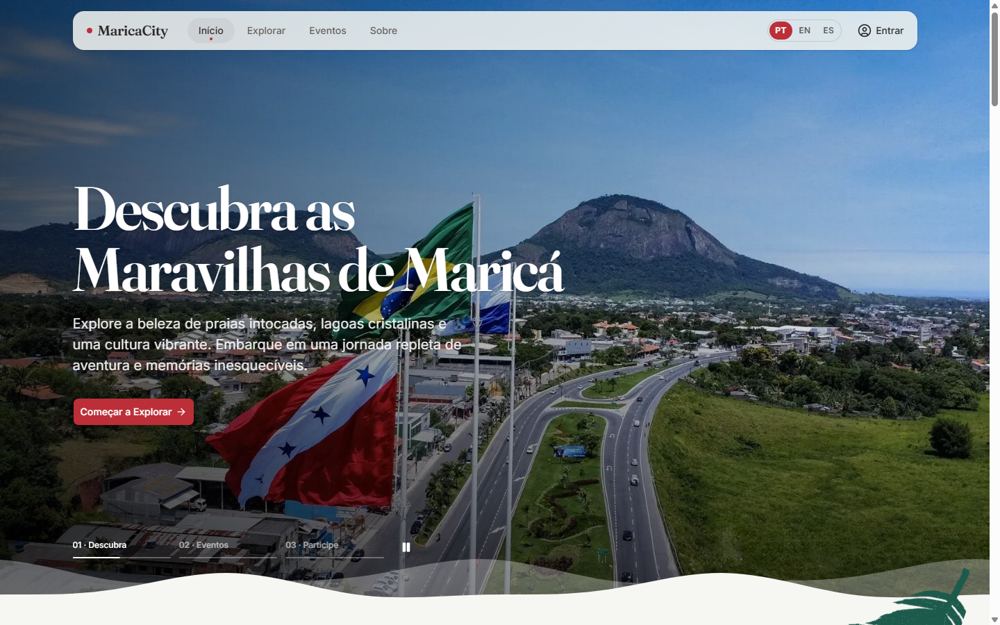
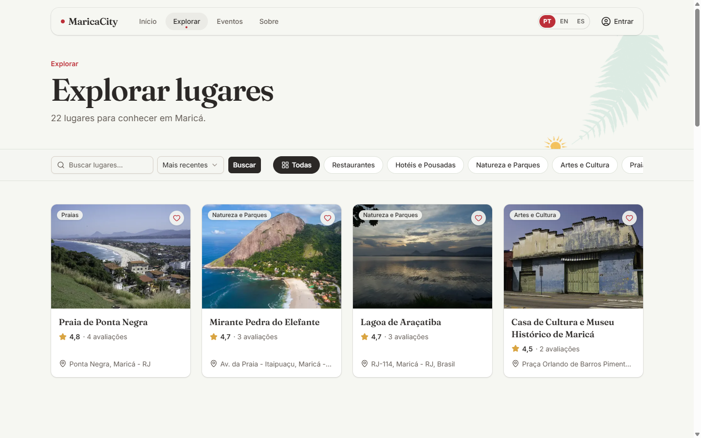
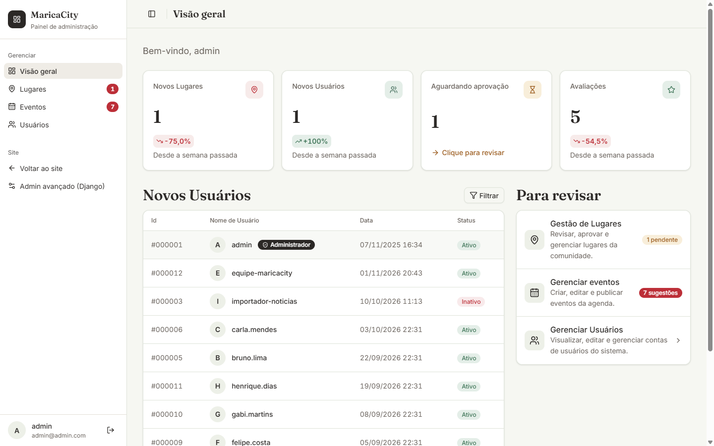

# MaricaCity

English | [Português](./README.pt-BR.md)

MaricaCity is a local tourism site for Maricá, a coastal city in Rio de Janeiro
state, Brazil. Visitors browse places, events and reviews in Portuguese,
English or Spanish. Registered users submit places, which go live only after a
moderator approves them. It runs in production at
**[marica-city.vercel.app](https://marica-city.vercel.app)**.

This is version 2 of an academic project. Version 1 is archived as
[Marica-City-v1](https://github.com/GabrielaPeroni/Marica-City-v1); v2 is a
rewrite focused on structure, tests, deployment and front-end quality.

<!--
Screenshots: put the files below in docs/screenshots/ and uncomment the tags.
Expected filenames:
  docs/screenshots/landing.png          landing page
  docs/screenshots/explore.png          /explore/ with filters
  docs/screenshots/place-detail.png     a place page (gallery, map, reviews)
  docs/screenshots/admin-dashboard.png  /painel-admin/
  docs/screenshots/mobile.png           landing or place page at phone width

<p align="center">
  
</p>
<p>
  
  
</p>
<p>
  
  
</p>
-->

_Screenshots to be added._

## Highlights

- **Places with moderation.** Users submit places with several photos; a
  moderator approves, rejects or asks for changes, and each decision is kept as
  history. Visitors only ever see approved places.
- **Reviews and favorites.** One 1 to 5 star review per user per place.
  Favorites update instantly in the UI and reconcile with the server in the
  background.
- **Events from the city portal.** A crawler reads the Prefeitura's public
  posts, extracts dates and venues, and puts candidates in a triage queue. Staff
  publish or discard them; nothing goes live unreviewed.
- **Three languages.** The interface is translated with Django's gettext
  catalogs; user and editorial content is translated by a local LLM and stored
  next to the original.
- **Email-verified signup.** A 6-digit code confirms the address before the
  account row is created; password reset works the same way.
- **Admin panel.** Approval queue and backlog, news and event management,
  user roles, weekly trend cards, plus the Django admin.
- **Production pipeline.** Linters, tests on PostgreSQL, a container
  smoke test and Lighthouse score floors run in CI; the app is deployed on
  Vercel with Neon Postgres and Cloudflare R2 for photos.

## Stack

| Layer      | Choice                                                                                       |
| ---------- | -------------------------------------------------------------------------------------------- |
| Backend    | Python 3.11+, Django 5.2, django-ratelimit, django-storages, Pillow                          |
| Data       | SQLite in development; PostgreSQL (Neon) in production; Redis cache optional                 |
| Frontend   | Django templates, django-cotton components, Tailwind CSS 4 + Basecoat, Lucide icons, Leaflet |
| JavaScript | Plain scripts, no bundler; ESLint                                                            |
| Delivery   | Docker image (gunicorn + whitenoise), Vercel serverless function, Cloudflare R2 for media    |
| Tooling    | uv, npm, black, isort, flake8, Prettier, pre-commit, GitHub Actions, Lighthouse CI, CodeQL   |

## Architecture

```text
Browser ── HTML (server-rendered) ──────────────┐
   │  small JS: favorites, maps, forms          │
   ▼                                            ▼
Vercel function / Docker (gunicorn)     Cloudflare R2 (photos)
   │  config.wsgi → middleware → apps
   ├── core      landing, admin panel, thumbnails, rate limit, translation helpers
   ├── accounts  User, email codes, login, user management
   ├── explore   Place, review, favorite, approval, visit; JSON map/favorites API
   └── news      News/events, EventCandidate, crawler
   │
   ├── PostgreSQL (Neon)         SQLite locally
   └── cache (Redis or LocMem)   email codes, rate limits, thumbnail lookups
```

Each Django app owns its models, views, forms, URLs and tests. Templates live
in `templates/`, the Tailwind source in `frontend/css/`, and the compiled CSS
is committed under `static/`. The directory map is in
[docs/STRUCTURE.md](./docs/STRUCTURE.md).

## Engineering decisions

**Content translation with source hashes.** Places, categories, reviews and
news store `translations` as JSON: `{"en": {...}, "es": {...}, "source": "<hash>"}`.
The hash covers the Portuguese fields, so `translate_content` (a local
Ollama model) only retranslates items whose source text changed, and templates
read the result with `{{ obj|tr:"field" }}`, falling back to Portuguese. The
site never calls the model at request time. See
`apps/core/content_translation.py`.

**Event crawler plus human triage.** `apps/news/event_crawler.py` pulls posts
from the Prefeitura's WordPress API, parses Portuguese dates and venues,
ignores past-tense announcements and de-duplicates by title similarity. Results
become `EventCandidate` rows; approving one creates a published `News` item.
The crawl is idempotent, so it is safe to run from a daily cron (Vercel) or a
6-hour scheduler (Docker).

**Moderation workflow.** `Place.is_approved` starts false. `PlaceApproval`
records every approve, reject or request-changes action and updates the place
when saved; `Place.objects.public()` is the single queryset behind everything a
visitor sees, and `place.can_edit(user)` centralizes owner-or-moderator checks.

**Thumbnails and blurred placeholders.** Uploads are never served at full size
in lists. `{{ img|srcset:"480,960" }}` generates WebP copies at 480, 960 and
1600 px on first use and store them beside the media. Each image also gets a
16 px WebP preview inlined as a data URI, which the browser stretches into a
blurred background while the real file loads.

**Optimistic UI and failure handling.** Every `fetch` goes through one
`request()` helper with a timeout and typed errors (offline, timeout, rate
limit, server). Favorites flip immediately, batch rapid clicks into one request
and roll back with a message on failure. Forms disable their buttons after the
first submit, a banner appears when the connection is offline or slow, and
broken images and maps degrade to a retryable state.

**Rate limiting.** `@limit("30/m", key="user")` wraps views that write or
search. Excess requests get a 429 with `Retry-After`: JSON for `fetch`, a
friendly page for browsers. On Vercel the client IP is read from the proxy
header.

**CI.** Pull requests run linters, `pip-audit`, a check that the compiled CSS
and icons are current, and the test suite on PostgreSQL 15 with a 90% coverage
floor. A second workflow builds the production image, runs `check --deploy`,
migrates, waits for the Docker healthcheck, smoke-tests pages, `robots.txt`,
`sitemap.xml` and hashed static files, then runs Lighthouse CI (accessibility,
best practices and SEO at 0.95 or higher, performance at 0.85 or higher). Pushes
to `main` publish the image to GHCR with an SBOM and provenance. After each
production deploy, a third workflow checks the live site.

**Printed-illustration generator.** The botanical shapes, gulls and skyline on
the pages are SVG files produced by `scripts/generate_deco.py` (smooth curves
through control points, seeded variation). Components `<c-deco>` and `<c-wave>`
place them; motion pauses offscreen and turns off with reduced motion.

## Running locally

Requires Python 3.11+, [uv](https://docs.astral.sh/uv/) and Node 22 (only to
rebuild CSS).

```bash
uv sync
cp .env.example .env            # set SECRET_KEY and GOOGLE_OAUTH_CLIENT_ID at least
uv run python manage.py migrate
uv run python manage.py load_demo_data   # optional: sample places, events, translations
uv run python manage.py createsuperuser  # optional
uv run python manage.py runserver

npm ci && npm run build:css     # only after changing templates' classes or icons
```

Signup sends a code by email. Locally, `docker compose up mailhog` catches it
at http://localhost:8025 and the code screen fills itself in development.
`docker compose up --build` runs the production image with Postgres and Redis.

## Tests

```bash
uv run python manage.py test apps
uv run coverage run manage.py test apps && uv run coverage report
```

The suite has 409 tests (`apps/<app>/tests/`). CI measures coverage with test
files included and requires 90%. Counting only application code, line coverage
is 82%.

## Deployment

Production runs on Vercel (region `gru1`, next to the Neon database), with
Cloudflare R2 for photos. Setup, environment variables, the cron and known
pitfalls are in [docs/DEPLOYMENT.md](./docs/DEPLOYMENT.md).

## Known gaps

- **Google sign-in is front end only.** `static/js/components/google_auth.js`
  posts a token to `/auth/google/`, but no view handles that route, so the
  button cannot sign anyone in. Email and password is the only working login.
- **Rate limits are per instance without a shared cache.** The default cache is
  in memory; on a serverless platform each instance counts separately, and email
  codes can be rejected by a different instance than the one that issued them.
  Set `CACHE_URL` or `REDIS_URL` to share state.
- **Translation needs a local LLM.** `translate_content` uses Ollama; machine
  translations are marked as such and can be corrected in the Django admin.
- **The event crawler depends on one portal.** If the Prefeitura changes its
  category IDs or post format, `crawl_events` needs updating.
- **Screenshots are not committed yet.**

## More documentation

[Structure](./docs/STRUCTURE.md) · [CRUD and permissions](./docs/CRUD.md) ·
[Contributing (Portuguese)](./docs/CONTRIBUTING.md) ·
[Deployment](./docs/DEPLOYMENT.md) · [Changelog](./CHANGELOG.md)

## License

Code under the [MIT License](./LICENSE). Photos come from Wikimedia Commons and
contributors, as credited in the site footer.
