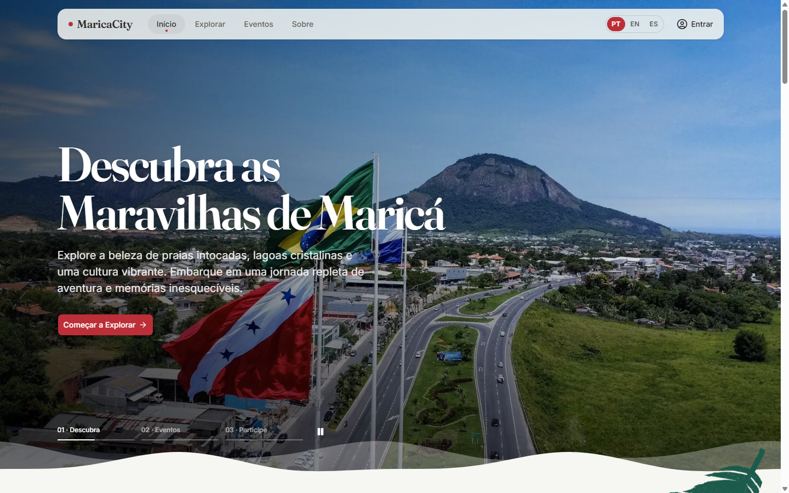
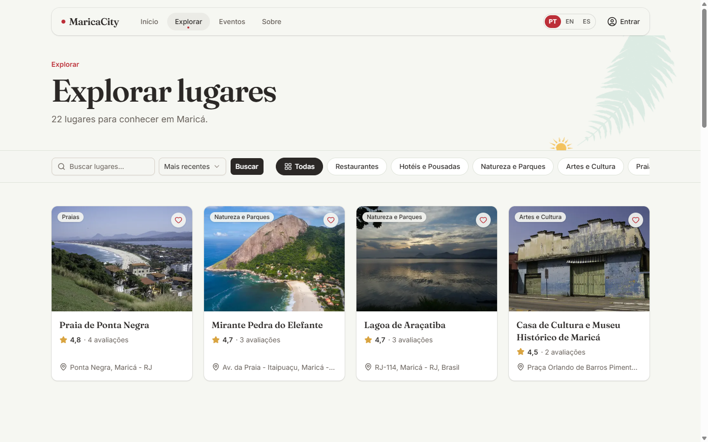
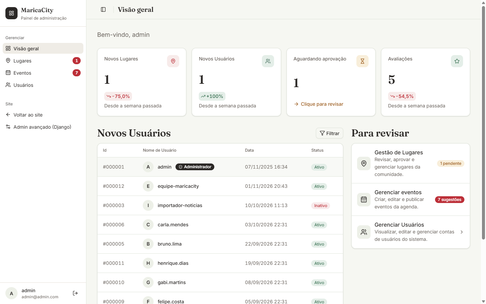

# MaricaCity

[English](./README.md) | Português

MaricaCity é um site de turismo local de Maricá, cidade litorânea do estado do
Rio de Janeiro. Visitantes navegam por lugares, eventos e avaliações em
português, inglês ou espanhol. Usuários cadastrados enviam lugares, que só
entram no ar depois que um moderador aprova. Está em produção em
**[marica-city.vercel.app](https://marica-city.vercel.app)**.

Esta é a versão 2 de um projeto acadêmico. A versão 1 está arquivada como
[Marica-City-v1](https://github.com/GabrielaPeroni/Marica-City-v1); a v2 é uma
reescrita voltada a estrutura, testes, deploy e qualidade do front-end.

<p align="center">
  
</p>
<p>
  
  
</p>
<p>
  
  
</p>

## Destaques

- **Lugares com moderação.** Usuários enviam lugares com várias fotos; um
  moderador aprova, rejeita ou pede mudanças, e cada decisão fica no histórico.
  Visitantes só veem lugares aprovados.
- **Avaliações e favoritos.** Uma avaliação de 1 a 5 estrelas por usuário e
  lugar. Os favoritos mudam na hora na interface e são reconciliados com o
  servidor em segundo plano.
- **Eventos do portal da Prefeitura.** Um crawler lê as publicações públicas,
  extrai datas e locais e coloca os candidatos numa fila de triagem. A equipe
  publica ou descarta; nada vai ao ar sem revisão.
- **Três idiomas.** A interface usa os catálogos gettext do Django; o conteúdo
  cadastrado é traduzido por um LLM local e guardado junto do original.
- **Cadastro com e-mail verificado.** Um código de 6 dígitos confirma o
  endereço antes de a conta ser criada; a recuperação de senha funciona igual.
- **Painel administrativo.** Fila de aprovação e backlog, gestão de notícias e
  eventos, papéis de usuário, cartões de tendência semanal, além do Django Admin.
- **Pipeline de produção.** Linters, testes em PostgreSQL, teste de fumaça do
  contêiner e pisos de nota do Lighthouse rodam na CI; o app roda na Vercel com
  Postgres da Neon e Cloudflare R2 para as fotos.

## Stack

| Camada      | Escolha                                                                                        |
| ----------- | ---------------------------------------------------------------------------------------------- |
| Backend     | Python 3.11+, Django 5.2, django-ratelimit, django-storages, Pillow                            |
| Dados       | SQLite em desenvolvimento; PostgreSQL (Neon) em produção; cache Redis opcional                 |
| Frontend    | Templates Django, componentes django-cotton, Tailwind CSS 4 + Basecoat, ícones Lucide, Leaflet |
| JavaScript  | Scripts simples, sem bundler; ESLint                                                           |
| Entrega     | Imagem Docker (gunicorn + whitenoise), função serverless na Vercel, Cloudflare R2 para mídia   |
| Ferramentas | uv, npm, black, isort, flake8, Prettier, pre-commit, GitHub Actions, Lighthouse CI, CodeQL     |

## Arquitetura

```text
Navegador ── HTML renderizado no servidor ──────┐
   │  JS pequeno: favoritos, mapas, formulários │
   ▼                                            ▼
Função Vercel / Docker (gunicorn)       Cloudflare R2 (fotos)
   │  config.wsgi → middleware → apps
   ├── core      landing, painel admin, miniaturas, limite de requisições, tradução
   ├── accounts  User, códigos por e-mail, login, gestão de usuários
   ├── explore   Place, avaliação, favorito, aprovação, visita; API JSON de mapa e favoritos
   └── news      Notícias/eventos, EventCandidate, crawler
   │
   ├── PostgreSQL (Neon)         SQLite localmente
   └── cache (Redis ou LocMem)   códigos por e-mail, limites, consultas de miniatura
```

Cada app Django tem seus modelos, views, formulários, URLs e testes. Os
templates ficam em `templates/`, a fonte do Tailwind em `frontend/css/` e o CSS
compilado é versionado em `static/`. O mapa de diretórios está em
[docs/STRUCTURE.md](./docs/STRUCTURE.md).

## Rodando localmente

Requer Python 3.11+, [uv](https://docs.astral.sh/uv/) e Node 22 (só para
recompilar o CSS).

```bash
uv sync
cp .env.example .env            # defina ao menos SECRET_KEY e GOOGLE_OAUTH_CLIENT_ID
uv run python manage.py migrate
uv run python manage.py load_demo_data   # opcional: lugares, eventos e traduções de exemplo
uv run python manage.py createsuperuser  # opcional
uv run python manage.py runserver

npm ci && npm run build:css     # só depois de mudar classes ou ícones nos templates
```

O cadastro envia um código por e-mail. Localmente, `docker compose up mailhog`
o recebe em http://localhost:8025 e a tela de código se preenche sozinha em
desenvolvimento. `docker compose up --build` roda a imagem de produção com
Postgres e Redis.

## Testes

```bash
uv run python manage.py test apps
uv run coverage run manage.py test apps && uv run coverage report
```

A suíte fica em `apps/<app>/tests/`. A CI mede a cobertura do código da aplicação,
sem os testes, e exige 80%.

## Documentação

[docs/STRUCTURE.md](./docs/STRUCTURE.md)
[docs/CRUD.md](./docs/CRUD.md)
[docs/CONTRIBUTING.md](./docs/CONTRIBUTING.md)
[docs/DEPLOYMENT.md](./docs/DEPLOYMENT.md)
[Changelog](./CHANGELOG.md)

Código sob a [licença MIT](./LICENSE). As fotos vêm do Wikimedia Commons e de
colaboradores, com crédito no rodapé do site.
